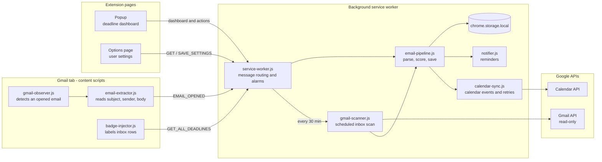
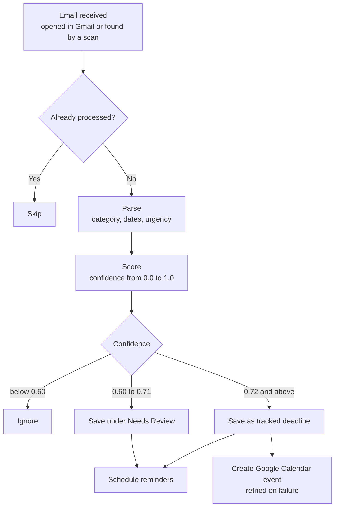

# Deadline OS

A Chrome extension that finds deadlines in your Gmail inbox, reminds you before they are due, and adds them to Google Calendar.

[](https://github.com/Mona-Agrawall/deadline-os/actions/workflows/test.yml)
[](LICENSE)
[](https://developer.chrome.com/docs/extensions/mv3/intro/)

---

## Contents

- [Overview](#overview)
- [Features](#features)
- [Architecture](#architecture)
- [How Detection Works](#how-detection-works)
- [Getting Started](#getting-started)
- [Configuration](#configuration)
- [Development](#development)
- [Project Structure](#project-structure)
- [Known Limitations](#known-limitations)
- [Roadmap](#roadmap)
- [Permissions and Privacy](#permissions-and-privacy)
- [License](#license)

---

## Overview

Important dates such as interviews, assignment submissions, fee payments and application deadlines are often buried in email. Deadline OS reads those emails, decides with transparent rules whether they contain a real deadline, and turns them into a tracked list with reminders and calendar events.

It works in two ways:

- **When you open an email** in Gmail, it is analysed immediately.
- **In the background**, the inbox is scanned through the Gmail API every 30 minutes.

All processing happens locally in the browser. The extension communicates only with Google's own APIs.

---

## Features

| Area | What it does |
|---|---|
| Inbox scanning | Searches recent, deadline-related mail every 30 minutes and filters out newsletters and marketing before parsing |
| Deadline detection | Recognises absolute, numeric, relative and weekday dates, attaches nearby times, and assigns a category and urgency |
| Confidence scoring | Scores every email from 0.0 to 1.0 and records the reasons behind the score |
| Dashboard | Popup grouping deadlines into Overdue, Today, This Week, Later, No Date and Needs Review |
| Reminders | Desktop notifications at user-chosen times, with Open Email and Mark Done actions |
| Google Calendar | Automatic events for high-confidence deadlines, with duplicate protection and a retry queue |
| Inbox badges | Coloured category labels next to matching emails in the Gmail inbox |
| Settings | Date format, reminder times, and trusted college and career domains |

### Categories

| Category | Typical emails |
|---|---|
| Interview | Interview confirmations, HireVue, phone screens, technical rounds |
| Assignment | Homework, project deadlines, internal exams, viva, lab submissions |
| Payment | Tuition and hostel fees, exam fees, EMIs |
| Application | Registration deadlines, placement drives, pre-placement offers |
| Event | Webinars, seminars, hackathons, workshops |
| Reminder | Action-required notices and general reminders |

---

## Architecture

The extension has three parts that communicate only through Chrome messages: content scripts running inside Gmail, extension pages (popup and settings), and a background service worker that owns all logic and data.



### Components

| Component | Responsibility |
|---|---|
| `service-worker.js` | Entry point. Loads all modules, schedules the scan, cleanup and retry alarms, and routes every message to a handler |
| `email-pipeline.js` | The single path every email follows, whether opened in Gmail or found by a scan |
| `gmail-scanner.js`, `gmail-api.js` | Gmail search query, quick pre-filter, and conversion of API messages into a common email format |
| `date-parser.js`, `parser.js` | Find dates and times in text; detect category and urgency; choose the most likely deadline |
| `scorer.js` | Weighted, explainable confidence score and the resulting action |
| `deduplicator.js`, `storage.js` | Fingerprinting, duplicate detection and persistence of deadlines |
| `storage-lock.js` | Runs storage writes one at a time so concurrent work cannot overwrite data |
| `settings.js` | User preferences with validation and defaults |
| `notifier.js` | Reminder alarms and desktop notifications |
| `auth.js`, `calendar.js`, `calendar-sync.js` | Google sign-in, calendar event creation, and the retry queue for failed syncs |

---

## How Detection Works



### Date recognition

| Written as | Interpreted as |
|---|---|
| `15th March 2027`, `March 15, 2027`, `Fri, 15 Mar` | Absolute dates, with or without weekday and year |
| `12/03/2027`, `12-03-27`, `12.03.2027` | Numeric dates, day-first by default (configurable) |
| `2027-03-12` | ISO dates |
| `today`, `tonight`, `tomorrow`, `day after tomorrow` | Relative days |
| `in 3 days`, `in two weeks` | Offsets from today |
| `Friday`, `this Friday`, `next Friday` | The next matching weekday |
| `5 PM`, `11:59 p.m.`, `17:30`, `noon`, `midnight` | A time near a date is attached to that date |

A date without a time is treated as 11:59 PM on that day. A date without a year that is long past, such as "Jan 5" read in December, is moved to the following year. When an email contains several dates, future dates introduced by deadline wording ("due", "last date", "closes") are preferred, then the soonest.

### Confidence scoring

Each signal adds to or subtracts from a raw total, which is divided by 11 and limited to the range 0 to 1.

| Signal | Weight |
|---|---|
| Strong category keyword | +3.0 |
| Placement platform (Haveloc) | +2.5 |
| College domain sender | +2.3 |
| Future date found | +2.0 |
| Career platform sender | +1.85 |
| Deadline keyword in subject | +1.5 |
| Placement keyword in subject | +1.5 |
| Critical urgency | +1.5 |
| Automated or no-reply sender | -1.5 |
| No date found | -2.5 |
| Engagement bait | -2.5 |
| Promotional subject | -3.0 |
| Marketing domain | -3.5 |
| Unsubscribe link (newsletter) | -4.0 |

| Confidence | Action |
|---|---|
| 0.72 and above | Saved and added to Google Calendar |
| 0.60 to 0.71 | Saved under Needs Review for the user to confirm |
| Below 0.60 | Ignored |

---

## Getting Started

### Requirements

- Google Chrome. Sign-in uses `chrome.identity`, which other Chromium browsers do not fully support.
- A Google account with Gmail.

### Installation

1. Clone the repository:

   ```bash
   git clone https://github.com/Mona-Agrawall/deadline-os.git
   ```

2. Open `chrome://extensions` and enable **Developer mode**.
3. Click **Load unpacked** and select the `deadline-os` folder.
4. Pin the extension to the toolbar.

### Google API setup

Access to Gmail and Calendar goes through an OAuth client that is tied to a single extension ID. The client ID in `manifest.json` belongs to the author's Google Cloud project, so anyone else running the extension needs their own:

1. In the [Google Cloud Console](https://console.cloud.google.com/), create a project and enable the **Gmail API** and the **Google Calendar API**.
2. Configure the **OAuth consent screen** (External, Testing) and add your Google account as a test user.
3. Copy the extension ID shown on `chrome://extensions`.
4. Create an **OAuth client ID** of type **Chrome Extension** using that ID.
5. Replace `oauth2.client_id` in `manifest.json` with the new client ID and reload the extension.

The ID of an unpacked extension depends on its folder location. If the folder moves, the ID changes and the OAuth client must be updated.

### First run

1. Open [Gmail](https://mail.google.com).
2. Open the extension popup and click **Connect** to grant read-only Gmail access and Calendar access.
3. Click **Scan** to run the first inbox scan.
4. Use the settings button in the popup to adjust preferences.

---

## Configuration

User settings are available from the popup's settings button, or from `chrome://extensions` under *Extension options*.

| Setting | Default | Effect |
|---|---|---|
| Date format | Day first (DD/MM/YYYY) | How ambiguous numeric dates such as `03/04/2027` are read |
| Reminders | 1 day, 1 hour, 15 minutes before | When notifications appear; existing reminders are rebuilt on save |
| College domains | `srmist.edu.in` and related | Most trusted senders; never filtered out |
| Career domains | `haveloc.com`, `hackerrank.com` and others | Trusted placement senders; never filtered out |

Developer-level values are constants at the top of their module:

| Value | Location |
|---|---|
| Score thresholds and weights | `ACTION_THRESHOLDS`, `WEIGHTS` in `background/scorer.js` |
| Scan size and search keywords | `MAX_RESULTS`, `SEARCH_KEYWORDS` in `background/gmail-scanner.js` |
| Scan, cleanup and retry intervals | `setupAlarms()` in `background/service-worker.js` |
| Marketing and blocked senders | `utils/sender-domains.js` |

---

## Development

The extension has no build step and no runtime dependencies. Node.js 20 or later is required only to run the tests.

```bash
npm install
npm test
```

The test suite uses Node's built-in test runner. Tests load the extension's real source files into a sandbox with a simulated `chrome` API and simulated Gmail and Calendar servers; the popup, the settings page and the Gmail content scripts run in [jsdom](https://github.com/jsdom/jsdom). GitHub Actions runs the suite on every push and pull request.

| Test file | Coverage |
|---|---|
| `date-parser.test.js` | All supported date and time formats, date order, year rollover, false positives |
| `parser.test.js`, `scorer.test.js` | Categories, urgency, deadline selection, scores and actions |
| `settings.test.js`, `storage.test.js`, `deduplicator.test.js` | Validation, persistence, duplicate detection, concurrent writes |
| `notifier.test.js`, `calendar.test.js` | Reminders, notifications, calendar events, retries, token refresh |
| `gmail-scanner.test.js`, `service-worker.test.js` | Complete scans and every message the service worker handles |
| `popup.test.js`, `options.test.js`, `content-scripts.test.js` | User interface, inbox badges and email detection |

### Debugging

Open the service worker console from `chrome://extensions` (Deadline OS, then **service worker**). Each processed email is logged with its category, score, action and the reasons for the score:

```
[Pipeline] "Interview Confirmation" → INTERVIEW (0.834) → auto_save ['Strong category match: INTERVIEW (interview)', ...]
```

Useful console commands:

```js
chrome.storage.local.get(null, console.log)   // inspect all stored data
chrome.storage.local.clear()                  // reset the extension
```

---

## Project Structure

```
deadline-os/
├── manifest.json            Extension manifest: permissions, OAuth, scripts
├── background/              Service worker and all application logic
│   ├── service-worker.js    Entry point, alarms, message routing
│   ├── email-pipeline.js    Shared processing path for every email
│   ├── gmail-scanner.js     Scheduled inbox scan and pre-filter
│   ├── gmail-api.js         Gmail REST calls and message conversion
│   ├── date-parser.js       Date and time recognition
│   ├── parser.js            Category, urgency and deadline selection
│   ├── scorer.js            Confidence scoring
│   ├── deduplicator.js      Email fingerprints
│   ├── storage.js           Deadline persistence
│   ├── storage-lock.js      Serialised storage writes
│   ├── settings.js          User settings
│   ├── notifier.js          Reminders and notifications
│   ├── auth.js              Google sign-in
│   ├── calendar.js          Calendar event creation
│   └── calendar-sync.js     Calendar sync and retry queue
├── content/                 Scripts injected into Gmail
│   ├── gmail-observer.js    Detects opened emails
│   ├── email-extractor.js   Reads the open email
│   └── badge-injector.js    Inbox badges
├── popup/                   Toolbar dashboard (HTML, CSS, JS)
├── options/                 Settings page (HTML, CSS, JS)
├── utils/                   Code shared by several parts
│   ├── categories.js        Category symbols
│   └── sender-domains.js    Trusted, marketing and blocked domains
├── assets/icons/            Extension icons
├── tests/                   Automated tests and test helpers
└── .github/workflows/       Continuous integration
```

---

## Known Limitations

- **Gmail page structure.** Reading an opened email depends on Gmail's HTML class names, which Google may change. Each field has fallback selectors, and the background scan uses the Gmail API, which does not depend on the page.
- **Publishing.** `gmail.readonly` is a restricted Google scope. Publishing on the Chrome Web Store requires Google's OAuth verification; until then only test users listed on the consent screen can sign in.
- **Rule-based detection.** Unusual wording may be missed or misread. Low-confidence results are placed under Needs Review rather than saved silently.

---

## Roadmap

- [x] Settings page for date format, reminders and trusted domains
- [ ] Add deadlines manually from the popup
- [ ] Export deadlines as an `.ics` file
- [ ] Custom snooze durations
- [ ] Firefox support

---

## Permissions and Privacy

| Permission | Purpose |
|---|---|
| `storage` | Stores deadlines and settings locally in the browser |
| `identity` | Signs in with Google for the Gmail and Calendar APIs |
| `notifications` | Shows deadline reminders |
| `alarms` | Schedules background scans and reminders |
| `https://mail.google.com/*` | Runs the content scripts that read opened emails and show badges |
| `https://www.googleapis.com/*` | Calls the Gmail and Google Calendar APIs |

All data is stored locally in `chrome.storage.local`. Gmail access is read-only, and no data is sent to any server other than Google's APIs.

---

## License

Released under the [MIT License](LICENSE).

## Author

**Mona Agrawal** — [GitHub](https://github.com/Mona-Agrawall)
